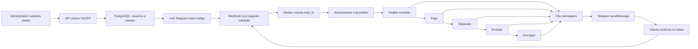

# PedidoJá — Projeto Integrador de APIs (Tema 03)

**Sistema de acompanhamento de pedidos em e-commerce**, com cadastro de clientes e produtos, geração de pedidos, cinco estágios de entrega, validação de CEP pelo ViaCEP e avisos automáticos por Telegram. O escopo foi construído sobre o Tema 03 do documento *Temas-Projeto-Integrador-APIs* (página 2), com os requisitos comuns e os Anexos A e B.

**Tecnologias:** Node.js 22 + Express 4, PostgreSQL 16, Telegram Bot API, ViaCEP, HTML/CSS/JavaScript, Docker Compose, GitHub Actions, Prometheus/Grafana (opcional) e AWS (EC2 + RDS + Route 53 + Caddy/Let's Encrypt).

> **Estado da entrega:** código, migrations, interface e testes unitários prontos para executar. A integração real exige um bot e um domínio do grupo. Este pacote **não constitui** prova de que o sistema já está em produção na AWS; ver `docs/PUBLICACAO_AWS.md`.

## 1. Primeira execução (Windows com Docker Desktop)

1. Instale Docker Desktop e Git. O Docker deve estar em execução.
2. Abra o terminal dentro desta pasta e copie o modelo de variáveis:

   ```powershell
   Copy-Item .env.example .env
   ```
3. No PowerShell, gere **dois segredos diferentes** (copie os valores para `.env`):

   ```powershell
   node -e "console.log(require('node:crypto').randomBytes(32).toString('hex'))"
   node -e "console.log(require('node:crypto').randomBytes(32).toString('hex'))"
   ```

   Preencha `ADMIN_API_KEY` com o primeiro e `TELEGRAM_WEBHOOK_SECRET` com o segundo. Não envie `.env` para o GitHub. Os campos `TELEGRAM_TOKEN` e `TELEGRAM_BOT_USERNAME` podem ficar vazios **somente para testar o painel sem notificações reais**.
4. Suba a infraestrutura:

   ```powershell
   docker compose up --build -d
   docker compose logs --tail=50 api
   ```

5. Abra **http://localhost:3000**. Clique em *Definir chave do painel*, coloque a mesma `ADMIN_API_KEY` do `.env` e clique em *Atualizar dados*.
6. Cadastre um produto, um cliente (CEP de teste: `01001-000`) e um pedido. O banco registra as etapas, as mensagens e os vínculos. **Sem Telegram ativado, as tentativas ficam marcadas como `falha / SEM_OPT_IN`**, comportamento intencional e auditável.
7. Opcionalmente, execute `npm install` e `npm run demo:seed` no terminal do computador para preencher um cliente, um produto e um pedido de exemplo (usa ViaCEP e necessita do servidor iniciado).
8. Finalize o trabalho local com `docker compose down` (mantenha os dados) ou `docker compose down -v` (APAGA o banco local).

### Com Telegram funcionando

1. No Telegram, abra `@BotFather`, envie `/newbot` e crie um username único terminado em `bot`.
2. No `.env`, configure `TELEGRAM_TOKEN` e `TELEGRAM_BOT_USERNAME` (sem `@`); reinicie:

   ```powershell
   docker compose up -d --build
   ```

3. O Telegram só envia mensagens ao cliente **depois de ele tocar em INICIAR** no link personalizado gerado no cadastro do PedidoJá. Esse link contém token aleatório de 48 caracteres, armazenado no banco apenas como SHA-256, e expira em 24h.
4. Para receber `/start`, respostas e botões, configure um **webhook público HTTPS**. Em desenvolvimento, exponha a porta local usando ngrok ou cloudflared, conforme o Anexo A.6 do PDF. Exemplo:

   ```powershell
   cloudflared tunnel --url http://localhost:3000
   ```

5. Coloque a URL HTTPS temporária no campo `PUBLIC_URL` do `.env`. Em um terminal com Node instalado, use:

   ```powershell
   npm install
   npm run webhook:registrar
   ```

   O comando usa `TELEGRAM_TOKEN`, `TELEGRAM_WEBHOOK_SECRET` e `PUBLIC_URL` do `.env`, e registra os tipos `message` e `callback_query`. Quando o túnel mudar, atualize `PUBLIC_URL` e repita.
6. Cadastre um cliente, gere/abra o convite, clique em INICIAR no Telegram e confirme que aparece **Vinculado** no painel após atualizar. Crie um pedido e avance os estados, aguardando o worker processar a fila. O cliente recebe botões **Confirmar ciência**; o clique muda o status da mensagem para `respondida`.

**Atenção:** `getUpdates` não funciona enquanto houver webhook cadastrado. Para depurar use `getWebhookInfo` e, se necessário, `deleteWebhook` na Bot API.

## 2. Fluxo funcional



**Regras de negócio:** o preço do pedido vem do PostgreSQL, nunca de um valor enviado pelo navegador; os itens guardam preços unitários do momento da venda; cada transição só permite avançar **uma etapa**; ViaCEP valida o CEP no cadastro e na criação do pedido, mas não confirma número residencial nem a entregabilidade física do endereço.

## 3. API REST

Todas as rotas `/api/*` exigem o cabeçalho `X-Admin-Key: SUA_CHAVE`. O webhook usa **outro** mecanismo de autorização (segredo do Telegram). Veja exemplos completos em `docs/API.md`.

| Método | Endpoint | Finalidade |
|---|---|---|
| GET | `/health` | Saúde do servidor e conexão com o banco |
| GET | `/metrics` | Métricas de contagem para o Prometheus |
| GET | `/api/cep/:cep` | Consulta e valida o CEP pelo ViaCEP |
| GET/POST | `/api/clientes` | Lista/cria clientes com endereços |
| POST | `/api/clientes/:id/vinculo` | Emite novo link Telegram com validade de 24h |
| GET/POST | `/api/produtos` | Lista/cadastra produtos |
| GET/POST | `/api/pedidos` | Lista/cria pedidos e seus itens |
| PATCH | `/api/pedidos/:id/status` | Avança o pedido à etapa seguinte |
| GET | `/api/pedidos/:id/historico` | Recupera a trilha de etapas |
| GET | `/api/mensagens` | Auditoria de mensagens (últimas 100) |
| GET | `/api/resumo` | Contadores do painel |
| POST | `/webhook/telegram` | Recebe eventos oficiais Telegram; valida header secreto |

## 4. Banco de dados

**Tabelas:** `usuarios`, `clientes`, `produtos`, `pedidos`, `itens_pedido`, `historico_status`, `vinculos_pendentes`, `canais_usuario`, `mensagens`, `webhook_updates` e `migrations`.

**Enums:** `status_pedido` = recebido/pago/separado/enviado/entregue; `status_msg` = enfileirada/enviada/falha/respondida; `plataforma_msg` = telegram/discord (tipo compartilhado do anexo, implementação ativa em Telegram). O projeto mantém os nomes de tabelas/colunas de mensageria do Anexo A.5.

**Migrations:** `db/migrations/001_schema.sql` e `002_optimizations.sql`. O comando `npm run db:migrate` cria a tabela de controle `migrations`, aplica scripts ordenados e usa advisory lock do PostgreSQL para impedir duas migrações simultâneas.

## 5. Testes e qualidade

```powershell
npm install
npm test
npm run lint
```

Os testes unitários cobrem transição de status, tokens/segredos, normalização de CEP, preços, botões e mocks de ViaCEP/Telegram. **Não substituem** testes ponta a ponta com PostgreSQL + Telegram real. A aplicação também inclui `.github/workflows/ci.yml` (lint e testes). O pipeline começa a operar depois de enviar os arquivos ao GitHub.

Checklist de demonstração: conferir um 401 no webhook sem cabeçalho; demonstrar webhook repetido processado uma vez; verificar `mensagens.id_externo` após envio; confirmar que clique no botão gera `respondida`; mostrar erro de CEP; tentar pular `recebido` direto para `entregue` e obter 409; desligar/religar worker e conferir fila.

## 6. Docker e observabilidade

- `docker-compose.yml`: app + worker + PostgreSQL local. O serviço de banco **não é usado em produção**.
- `docker compose --profile observability up -d`: adiciona Prometheus `127.0.0.1:9090` e Grafana `127.0.0.1:3001` (senha definida em `GRAFANA_PASSWORD` no `.env`). Métricas: `pedidoja_pedidos_total`, `pedidoja_mensagens_total` e `pedidoja_mensagens_falha`.
- `compose.prod.yml`: app + worker + Caddy. A URL do PostgreSQL **aponta para o Amazon RDS** (fora do compose). O arquivo `Caddyfile` define o domínio e fornece TLS via Let's Encrypt, desde que DNS/portas estejam corretos.

## 7. AWS: serviço, DNS, HTTPS e custo

**Provedor escolhido:** AWS. **Justificativa:** permite demonstrar diretamente EC2 (VM), RDS PostgreSQL (gerenciado) e Route 53 (DNS), além de usar Caddy para certificado Let's Encrypt na VM sem balanceador pago. Passo a passo e roteiro de pesquisa no arquivo **`docs/PUBLICACAO_AWS.md`**.

**Obrigatório antes da entrega acadêmica:** URL real, certificado válido, prints EC2/RDS e regras de rede, migrations executadas na nuvem, DNS/`nslookup`, webhook no domínio final, alerta de custo AWS Budgets, consumo e relatório de testes. Estes itens **exigem contas e ações do grupo**, portanto não são simulados neste ZIP.

## 8. Controle de versão e entregas

Criar repositório GitHub e realizar commits reais durante cada aula. Ao final de cada encontro, marcar a versão **correspondente ao que foi efetivamente feito**:

```powershell
git init
git add .
git commit -m "aula-01: inicio do projeto PedidoJa"
git branch -M main
git tag aula-01
# Repita em cada aula: git commit -m "aula-02: requisitos"; git tag aula-02
# Ao concluir e validar o projeto: git tag -a v1.0.0 -m "Entrega final validada"
# Depois de configurar a URL remota: git push -u origin main --tags
```

**Não crie tags fictícias apenas para cumprir avaliação**: tags `aula-01` a `aula-18` devem identificar commits reais do desenvolvimento, com evidência de cada aula. Um pacote gerado não substitui o histórico de Git.

## 9. Documentos inclusos

- `docs/API.md` — endpoints, corpos JSON e respostas de exemplo.
- `docs/REQUISITOS_E_CASOS_DE_USO.md` — requisitos funcionais, não funcionais, regras de negócio, ER e testes.
- `docs/PUBLICACAO_AWS.md` — procedimento de produção EC2 + RDS + Route 53 + HTTPS e custos.
- `docs/PLANO_ENTREGA.md` — verificação item a item e evidências reais pendentes.
- `docs/ROTEIRO_APRESENTACAO.md` — script narrado e sequência da demonstração.
- Fora desta pasta, foram preparados documentos e slides complementares, indicados nos links de entrega.

## 10. Referências técnicas

- Enunciado fornecido pelo professor: *PROJETO INTEGRADOR — TEMAS*, p. 1–2 e anexos A/B (material de aula).
- [Telegram Bot API](https://core.telegram.org/bots/api) — `setWebhook`, `sendMessage`, `answerCallbackQuery`, `secret_token`.
- [ViaCEP](https://viacep.com.br/) — validação de CEP e retorno `erro: true`.
- [Node.js](https://nodejs.org/en/docs), [PostgreSQL](https://www.postgresql.org/docs/), [Docker Compose](https://docs.docker.com/compose/).
- [Amazon EC2](https://docs.aws.amazon.com/ec2/), [Amazon RDS PostgreSQL](https://docs.aws.amazon.com/AmazonRDS/latest/UserGuide/CHAP_PostgreSQL.html), [Route 53](https://docs.aws.amazon.com/Route53/latest/DeveloperGuide/), [Caddy](https://caddyserver.com/docs/).

**Integrantes:** [preencher nomes]. **Professor:** [preencher]. **Instituição:** [preencher]. **Curso/turma:** [preencher].
