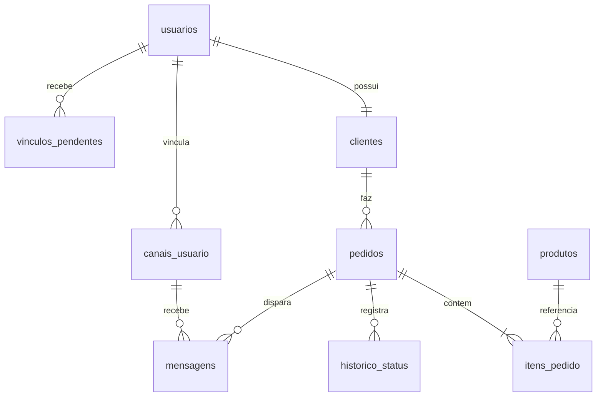

# Documento de requisitos e projeto — PedidoJá

## 1. Identificação
**Tema:** 03 — PedidoJá — Status de pedido no e-commerce. **Plataforma de mensageria selecionada:** Telegram. **Segunda API:** ViaCEP. **Stack:** Node.js, PostgreSQL e Docker. **Provedor de nuvem selecionado:** AWS.

## 2. Problema e objetivos
Clientes querem saber o andamento das compras sem abrir o site. O sistema centraliza os cadastros e o ciclo do pedido, com emissão automática de avisos pelo Telegram. Objetivo geral: oferecer rastreabilidade dos pedidos e reduzir a necessidade de consultas manuais. Objetivos específicos: validar o CEP via API pública, manter histórico auditável, obter opt-in do cliente, registrar mensagens de entrada/saída e permitir operação em nuvem HTTPS.

## 3. Atores
- **Administrador da loja:** mantém clientes, produtos e pedidos, altera o status e consulta os logs.
- **Cliente:** ativa o bot por link, recebe atualizações, confirma que tomou ciência de uma mensagem e consulta o pedido por `/pedido NUMERO`.
- **Telegram:** recebe mensagens da API e chama o webhook com mensagens e interações.
- **ViaCEP:** valida/normaliza dados do CEP.

## 4. Requisitos funcionais
| ID | Requisito | Implementação |
|---|---|---|
| RF01 | Cadastrar clientes com endereço | `POST /api/clientes` |
| RF02 | Validar CEP no cadastro e na entrega | Serviço ViaCEP + `POST /api/pedidos` |
| RF03 | Manter catálogo e preços | `/api/produtos` |
| RF04 | Criar pedidos e itens | `POST /api/pedidos` |
| RF05 | Permitir estados em ordem | `PATCH /api/pedidos/:id/status` |
| RF06 | Registrar histórico de estados | `historico_status` |
| RF07 | Gerar link de vínculo com bot | `vinculos_pendentes`, `canais_usuario` |
| RF08 | Enviar mensagem a cada mudança | Fila `mensagens` + worker |
| RF09 | Receber mensagens e botões por webhook | `POST /webhook/telegram` |
| RF10 | Rastrear enfileirada/enviada/falha/respondida | `mensagens.status` |
| RF11 | Exibir painel responsivo | `public/` |
| RF12 | Registrar payload bruto e idempotência | `webhook_updates` e `mensagens.payload_bruto` |
| RF13 | Consultar pedido via bot | Comando `/pedido NUMERO` |
| RF14 | Mostrar mensagens e indicadores | `/api/mensagens`, `/api/resumo` |

## 5. Requisitos não funcionais
- **RNF01 Segurança:** variáveis sensíveis fora do Git e webhook com segredo. HTTPS obrigatório em produção.
- **RNF02 Persistência:** PostgreSQL com migrations versionadas e integridade referencial.
- **RNF03 Resiliência:** fila com retentativas/backoff em HTTP 429, tratamento de 403 e registro de falhas.
- **RNF04 Idempotência:** duplicatas do mesmo `update_id` não devem criar duas interações.
- **RNF05 Implantação:** Docker Compose local; AWS EC2 + Amazon RDS em produção, DNS Route 53 e HTTPS via Caddy.
- **RNF06 Qualidade:** lint, testes unitários e CI com GitHub Actions.
- **RNF07 Observabilidade:** métricas Prometheus e infraestrutura Grafana no perfil `observability`.

## 6. Regras de negócio
**RN01:** somente usuário que iniciou contato pode ser notificado. **RN02:** todo pedido nasce em `recebido`. **RN03:** transições não podem pular etapas. **RN04:** o preço usado na venda vem do catálogo e é congelado no item. **RN05:** um código de convite expira em 24h e só é usado uma vez. **RN06:** mesmo cliente pode regenerar link; o anterior deixa de valer. **RN07:** clique deve corresponder a mensagem e pedido vinculados ao mesmo cliente. **RN08:** todo resultado de envio deve ficar registrado, inclusive sem opt-in. **RN09:** revalidação por CEP não prova número residencial. **RN10:** Telegram não fornece “entregue/lido”; a confirmação do botão produz `respondida`.

## 7. Casos de uso
**UC01 — Cadastrar cliente:** administrador preenche nome, e-mail, CEP, número. A API consulta ViaCEP, armazena endereço, retorna link. Exceções: CEP errado/indisponível, e-mail repetido.

**UC02 — Vincular Telegram:** cliente abre link exclusivo, manda `/start codigo`. O endpoint valida segredo da plataforma, grava update idempotente; worker confirma token dentro da validade, associa `chat_id` e envia boas-vindas.

**UC03 — Criar pedido:** administrador seleciona cliente e produtos, informa quantidades. A API revalida CEP, lê preços atuais, grava pedido e itens, registra estágio inicial e enfileira notificação. Exceção: cliente ainda não vinculado -> registra falha de envio para não falsificar entrega.

**UC04 — Avançar etapa:** operador seleciona a próxima etapa permitida. A atualização é transacional, grava histórico e enfileira mensagem. Exceção: pular ou repetir etapa -> HTTP 409.

**UC05 — Confirmar ciência:** cliente clica no botão Telegram. Webhook recebe `callback_query` com segredo, worker verifica chat, pedido e mensagem, e atualiza a mensagem enviada para `respondida`.

**UC06 — Consultar pedido:** cliente manda `/pedido 12` no bot. O worker consulta o PostgreSQL **somente para o cliente vinculado** e responde com o status, ou informa que não localizou o pedido.

## 8. Esquema simplificado

## 9. Arquitetura em camadas
**Interface** em `public/` → **REST API Express** em `src/server.js` → **serviços de domínio** (`orders`, `viacep`, `webhooks`, `outbox`, `telegram`) → **PostgreSQL**. Entrada Telegram é persistida rapidamente em `webhook_updates`; um **worker independente** processa o evento e envia respostas, evitando demorar no webhook. Saídas são inseridas primeiro na tabela `mensagens`; o worker obtém cada item da fila com leasing/`SKIP LOCKED`. Em produção Caddy termina HTTPS e encaminha a API, e o PostgreSQL fica no RDS isolado da Internet.

## 10. Matriz de testes
| ID | Teste | Resultado esperado |
|---|---|---|
| CT01 | Criar cliente com CEP válido | 201 e endereço preenchido |
| CT02 | Usar CEP inválido/inexistente | 422 e mensagem compreensível |
| CT03 | Criar produto com preço zero | 422 |
| CT04 | Criar pedido com dois produtos | Total em centavos do banco |
| CT05 | Saltar de recebido para entregue | 409 |
| CT06 | Alterar status e conferir histórico | Um novo evento e uma mensagem |
| CT07 | Repetir um update_id do Telegram | Sem duplicar |
| CT08 | Enviar webhook com segredo errado | 401 |
| CT09 | Telegram responder HTTP 429 | Retry programado / erro registrado |
| CT10 | Telegram retornar HTTP 403 | Canal inativado e falha registrada |
| CT11 | Clicar no botão do pedido | Mensagem vira `respondida` |
| CT12 | Bot `/pedido` de cliente não dono | Não revela pedido alheio |

**Estado da validação:** testes unitários de funções e serviços com mocks podem ser executados via `npm test`; CT01, CT04, CT06–CT12 exigem execução integrada com PostgreSQL/Telegram e devem ser documentados pelo grupo com prints/logs reais após configuração.

## 11. Limitações assumidas
Este MVP não processa pagamentos, não integra uma transportadora nem controla estoque: status **pago** é uma alteração administrativa, não uma transação financeira verificada. O bot não encaminha números de rastreio nem comprova recebimento físico. O painel utiliza uma chave de administrador, adequada ao exercício e não a uma plataforma comercial multiusuário. Nenhuma métrica de disponibilidade ou publicação real pode ser afirmada antes de executar e registrar evidências.
